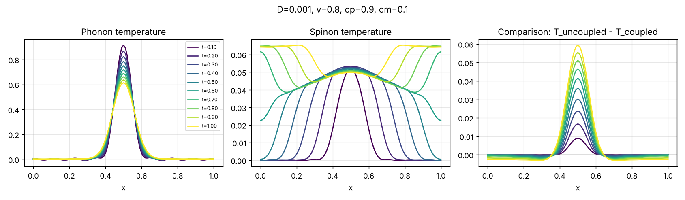
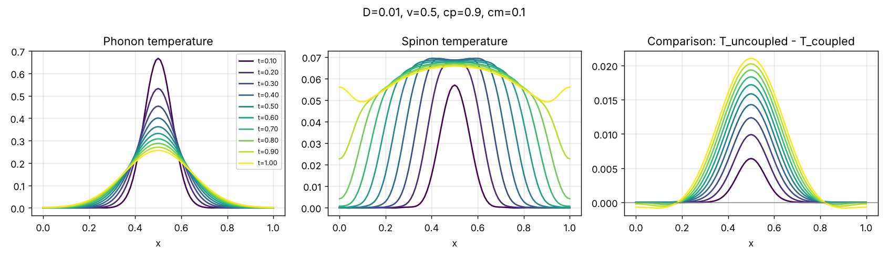
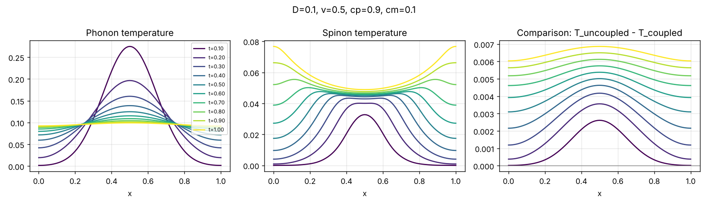

# Ballistic thermal transport coupled to phonons

A C++ solver for heat transport in spin-chain compounds, where a **ballistic magnetic** component (spinons) exchanges energy with a **diffusive phononic** one. It was written for my BSc thesis at the University of Crete (2020), supervised by Prof. Xenophon Zotos, and supports the first-author paper:

> P. Zavitsanos and X. Zotos, *Ballistic magnetic thermal transport coupled to phonons*, [Physical Review B 104, 024429 (2021)](https://journals.aps.org/prb/abstract/10.1103/PhysRevB.104.024429) · [arXiv:2102.08718](https://arxiv.org/abs/2102.08718)

📄 [BSc thesis](https://elocus.lib.uoc.gr/dlib/8/1/0/attached-metadata-dlib-1606475021-18686-31682/Zavitsanos_Panagiotis.pdf) · 📊 [Thesis presentation](docs/presentation.pdf)



## The idea

The standard two-temperature (Sanders–Walton) model treats both phonons and magnetic excitations as diffusive:

```math
C_p\,\partial_t T_p = \kappa_p\,\partial_x^2 T_p - g\,(T_p - T_m), \qquad
C_m\,\partial_t T_m = \kappa_m\,\partial_x^2 T_m - g\,(T_m - T_p)
```

It therefore cannot describe **ballistic** transport by spinons in spin-1/2 Heisenberg chains such as $\mathrm{SrCuO_2}$. This model replaces the magnetic diffusion equation with an **advection** equation for right- and left-moving carriers $T_+$ and $T_-$, coupled to diffusive phonons through a relaxation time $\tau$.

When a Gaussian heat pulse is placed in the phonons, the spinons carry heat outwards as **two counter-propagating fronts**. Through the coupling they leave two travelling bumps on the phonon profile. This two-bump feature is a direct signature of ballistic transport that a flash (time-resolved) experiment could look for.

## Model equations

The temperature difference between the two subsystems relaxes as $\partial_t \Delta T = -\Delta T/\tau$ with $\Delta T = T_p - T_m$ and $T_m = (T_+ + T_-)/2$. Adding phonon diffusion and ballistic spinon propagation at speed $v$ gives the coupled advection–diffusion system

```math
\frac{\partial T_p}{\partial t} = D\,\frac{\partial^2 T_p}{\partial x^2} + \frac{c_m}{C}\,\frac{T_m - T_p}{\tau}
```

```math
\frac{\partial T_\pm}{\partial t} \pm v\,\frac{\partial T_\pm}{\partial x} = \frac{c_p}{C}\,\frac{T_p - T_\pm}{\tau}
```

where $C = c_p + c_m$ and $D = \kappa_p / c_p$. The total heat current is

```math
Q = Q_p + Q_m = -\kappa_p\,\frac{\partial T_p}{\partial x} + v\,\frac{c_m}{2}\,\bigl(T_+ - T_-\bigr).
```

### Steady state

On $-L/2 < x < L/2$ with $Q_m = 0$ at the ends, the steady-state equations solve analytically:

```math
T_p(x) = T_0 - \left(\frac{B x}{A^2} - \frac{\left(B/A^2 - 1/\kappa_p\right)\sinh Ax}{A\cosh (AL/2)}\right) Q,
\qquad
A^2 = \frac{1}{C\tau}\left(\frac{c_p c_m}{\kappa_p} + \frac{c_p^2}{\kappa}\right),
\qquad
B = \frac{1}{C\tau}\,\frac{c_p^2}{\kappa\,\kappa_p}
```

with $\kappa = C v^2 \tau$ acting as an effective *transfer thermal conductivity* between the two subsystems. The effective conductivity measured across the sample is

```math
\kappa_{\mathrm{eff}} = -\frac{QL}{\Delta T_p} = \left[\frac{B}{A^2} - \frac{B/A^2 - 1/\kappa_p}{AL}\tanh\frac{AL}{2}\right]^{-1}
\;\xrightarrow{\;AL \to \infty\;}\; \kappa_p + \kappa .
```

`src/steady_state.cpp` evaluates these profiles for the spin-chain and spin-ladder cases.

## Computational method: from PDEs to ODEs

The time-dependent problem is solved with a **Fourier method of lines**. The spatial dependence is moved into Fourier coefficients, the PDEs become ODEs in time for those coefficients, the ODEs are integrated with fourth-order Runge–Kutta, and the temperature profiles are rebuilt with an inverse transform at every step.

### 1. Fourier expansion and boundary conditions

On a sample of length $L$ (scaled to $L = 1$) with no heat current through the ends,

```math
Q_p = 0 \;\Rightarrow\; \partial_x T_p\big|_{x=0,L} = 0, \qquad
Q_m = 0 \;\Rightarrow\; T_+\big|_{x=0,L} = T_-\big|_{x=0,L}.
```

These are satisfied by cosine and sine series with $q_n = \pi n / L$:

```math
T_p(x,t) = \frac{a_0(t)}{2} + \sum_{n=1}^{N} a_n(t)\cos q_n x,
\qquad
T_\pm(x,t) = \frac{b_0(t)}{2} + \sum_{n=1}^{N} \Bigl[\, b_n(t)\cos q_n x \pm c_n(t)\sin q_n x \,\Bigr].
```

### 2. Discrete Fourier transform of the initial condition

The initial state is a narrow Gaussian heat pulse in the phonons, with the spinons cold:

```math
T_p(x,0) = e^{-300\,(x - 1/2)^2}, \qquad T_\pm(x,0) = 0 .
```

Its Fourier coefficients are computed numerically with **Simpson's rule** on 100 sub-intervals:

```math
a_n(0) = \frac{2}{L}\int_0^L T_p(x,0)\cos q_n x\,dx
\;\approx\; \frac{h}{3}\Bigl[f_0 + 4\!\!\sum_{\text{odd } j} f_j + 2\!\!\sum_{\text{even } j} f_j + f_{M}\Bigr],
\qquad b_n(0) = c_n(0) = 0 .
```

### 3. The PDEs become ODEs

Substituting the series into the PDEs, each spatial derivative turns into a multiplication by $q_n$, and every mode evolves independently. The zero mode (total energy exchange) has an exact solution,

```math
a_0(t) = a_0(0) - \frac{c_m}{C}\bigl(a_0 - b_0\bigr)\big|_{0}\left(1 - e^{-t/\tau}\right),
\qquad
b_0(t) = b_0(0) - \frac{c_p}{C}\bigl(b_0 - a_0\bigr)\big|_{0}\left(1 - e^{-t/\tau}\right),
```

and each finite wavevector $q_n$ gives a coupled system of three linear ODEs:

```math
\begin{aligned}
\dot a_n &= -D q_n^2\, a_n - \frac{c_m}{C\tau}\,(a_n - b_n) \\
\dot b_n &= -v q_n\, c_n - \frac{c_p}{C\tau}\,(b_n - a_n) \\
\dot c_n &= \phantom{-}v q_n\, b_n - \frac{c_p}{C\tau}\, c_n
\end{aligned}
```

The $-Dq_n^2$ term is phonon diffusion (damping that grows with $n^2$), the $\pm v q_n$ terms rotate the spinon cosine and sine parts into each other (ballistic propagation), and the $1/\tau$ terms exchange energy between the subsystems.

### 4. Time evolution with fourth-order Runge–Kutta

Writing each mode as $\mathbf{y}_n = (a_n, b_n, c_n)^{\mathsf T}$ with $\dot{\mathbf{y}}_n = \mathbf{f}_n(\mathbf{y}_n)$, one step of size $h$ is

```math
\begin{aligned}
\mathbf{k}_1 &= h\,\mathbf{f}_n(\mathbf{y}_n), &
\mathbf{k}_2 &= h\,\mathbf{f}_n\!\left(\mathbf{y}_n + \tfrac{1}{2}\mathbf{k}_1\right), \\
\mathbf{k}_3 &= h\,\mathbf{f}_n\!\left(\mathbf{y}_n + \tfrac{1}{2}\mathbf{k}_2\right), &
\mathbf{k}_4 &= h\,\mathbf{f}_n\!\left(\mathbf{y}_n + \mathbf{k}_3\right),
\end{aligned}
\qquad
\mathbf{y}_n(t+h) = \mathbf{y}_n(t) + \tfrac{1}{6}\bigl(\mathbf{k}_1 + 2\mathbf{k}_2 + 2\mathbf{k}_3 + \mathbf{k}_4\bigr).
```

The three components of each stage are advanced together, so the coupling between $a_n$, $b_n$ and $c_n$ is kept to fourth order. The solver uses $N = 16$ modes (17 coefficients), $h = 10^{-3}$ and $10^4$ steps.

### 5. Inverse Fourier transform

At every time step the profiles are rebuilt on a grid $x_k = k\,\Delta x$, $\Delta x = 0.01$:

```math
T_p(x_k,t) = \frac{a_0}{2} + \sum_{n=1}^{N} a_n(t)\cos q_n x_k,
\qquad
T_m(x_k,t) = \frac{T_+ + T_-}{2} = \frac{b_0}{2} + \sum_{n=1}^{N} b_n(t)\cos q_n x_k .
```

### 6. Validity check: energy conservation

With zero-current boundaries the total energy must stay constant. The solver integrates it at every step,

```math
E(t) = \sum_k \Delta x\,\Bigl[c_p\,T_p(x_k,t) + c_m\,T_m(x_k,t)\Bigr],
```

and it stays constant to within 1% over the whole run.

### 7. The comparison test

The ballistic bumps are small compared with the central peak. To expose them, the solver also evolves an **uncoupled** phonon system ($\tau \to \infty$, pure diffusion), whose modes obey $\dot a_n^{\,\mathrm{d}} = -Dq_n^2\, a_n^{\,\mathrm{d}}$, and outputs

```math
\Delta T(x,t) = T_p^{\,\mathrm{uncoupled}}(x,t) - T_p^{\,\mathrm{coupled}}(x,t).
```

Negative values of $\Delta T$ appearing **symmetrically on both sides of the centre** show where the counter-propagating carriers have deformed the phonon curve. The larger $v$, the sooner they appear.

## Results

Fixing three parameters and varying one at a time ($c_p = 0.9$, $c_m = 0.1$):





As $D$ grows, the phonon peak flattens faster and the deformations in the comparison curve disappear.

**Experimental guidelines.** Ballistic transport is easiest to observe when

- the phonon diffusion constant $D$ is **small**,
- the spinon velocity $v$ is **large**,
- the heat-capacity ratio $c_p/c_m \to 1$.

## Build and run

```bash
g++ -O2 -o coupled_transport src/coupled_transport.cpp
./coupled_transport 0.001 0.8 0.9 0.1    # D v cp cm  (about 6 s)
python plot_profiles.py "D=0.001, v=0.8"  # needs numpy and matplotlib
```

With no arguments the solver uses $D = 0.1$, $v = 1.0$, $c_p = 0.9$, $c_m = 0.1$.

## Files

| File | Purpose |
|---|---|
| `src/coupled_transport.cpp` | Time-dependent solver (phonons, spinons, uncoupled comparison, energy) |
| `src/steady_state.cpp` | Steady-state profiles for spin chain and spin ladder |
| `plot_profiles.py` | Phonon, spinon and comparison plots; prints the energy drift |
| `docs/` | Example figures and the thesis presentation |
